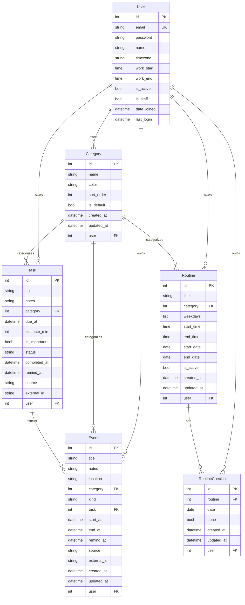

# Calibre Backend Architecture

## Overview

Calibre is a productivity app ("Own your Time") built for IIT Bombay's Software Lab (CS699). It unifies tasks, events and routines, shows what matters now, finds free time, runs focus sessions, tracks progress, does spaced-repetition revision, journals, and imports deadlines from IITB Moodle. A Flutter app is the client. This repo is the Django + Django REST Framework backend.

### App List and Build Order

The backend is organized into multiple apps, each handling a specific domain. Apps are built in this order to respect dependencies:

| # | App | Purpose | Dependencies |
|---|-----|---------|--------------|
| 1 | `accounts` | User authentication and profile | None (must be first) |
| 2 | `common` | Shared base models, mixins, categories | accounts |
| 3 | `tasks` | Core task entity | accounts, common |
| 4 | `planner` | Events, routines, agenda, free slots | accounts, common, tasks |
| 5 | `integrations` | Moodle sync (writes tasks/events) | accounts, common, tasks, planner |
| 6 | `focus` | Focus sessions linked to tasks | accounts, tasks |
| 7 | `revision` | Spaced-repetition topics and queue | accounts (feeds planner later) |
| 8 | `journal` | Journal entries with context | accounts, tasks, events, focus |
| 9 | `analytics` | Read-only summary stats | accounts, tasks, events, focus |
| 10 | `activity` | Screen-time ingestion | accounts |

The `accounts`, `common`, `tasks`, and `planner` apps are implemented in this phase.

## Layering

The codebase follows a strict layered architecture to make data flow easy to explain and debug:

```
urls.py → views.py → serializers.py → services.py → models.py → DB
```

- **urls.py**: Route definitions only. Maps HTTP paths to views.
- **views.py**: Thin layer. Handles auth, parses request, calls serializer/service, returns response. No business logic beyond a few lines.
- **serializers.py**: Validation and data shaping. Converts between Django models and JSON. Should not touch more than one model.
- **services.py**: Business logic that spans models or has more than a few lines. This is where complex operations live.
- **models.py**: Data definitions and tiny methods. Should only know about its own table.
- **DB**: SQLite (dev) or Postgres (prod). Stores the actual data.

**Rule**: Never put business logic in views or serializers if it touches more than one model. Push it down to services.

## Request Flow

### (a) Register Flow (with Category Seeding)

1. Client sends `POST /api/v1/auth/register/` with `{"email": "...", "password": "...", "name": "..."}`
2. `urls.py` routes to `RegisterView`
3. `RegisterView.create()` calls `RegisterSerializer.validate()` to check email uniqueness and password strength
4. `RegisterSerializer.create()` calls `register_user()` from `accounts/services.py`
5. `register_user()` uses `UserManager.create_user()` to create the user (with password hashing)
6. User is saved to `accounts_user` table
7. `register_user()` calls `seed_default_categories(user)` from `common/services.py`
8. `seed_default_categories()` creates 8 default categories (Academics, Work, Personal, etc.) for the user
9. Categories are saved to `common_category` table
10. `RegisterView.create()` issues JWT tokens via `RefreshToken.for_user(user)`
11. Response: `{"user": {...}, "access": "...", "refresh": "..."}` with 201 status

**Files touched (in order)**:
- `apps/accounts/urls.py` (route)
- `apps/accounts/views.py` (RegisterView)
- `apps/accounts/serializers.py` (RegisterSerializer)
- `apps/accounts/services.py` (register_user)
- `apps/accounts/models.py` (User + UserManager)
- `apps/common/services.py` (seed_default_categories)
- `apps/common/models.py` (Category)
- DB (accounts_user and common_category tables)

### (b) Authenticated Request to `/users/me/`

1. Client sends `GET /api/v1/users/me/` with `Authorization: Bearer <access_token>` header
2. `urls.py` routes to `UserMeView`
3. DRF JWT authentication middleware validates the token and sets `request.user`
4. `UserMeView.get_object()` returns `request.user`
5. `UserMeView.get_serializer_class()` returns `UserSerializer`
6. `UserSerializer` serializes the user object (read-only fields only)
7. Response: `{"id": ..., "email": ..., "name": ..., ...}` with 200 status

**Files touched (in order)**:
- `apps/accounts/urls.py` (route)
- `apps/accounts/views.py` (UserMeView)
- `apps/accounts/serializers.py` (UserSerializer)
- `apps/accounts/models.py` (User - implicit via serializer)

### (c) Logout Flow

1. Client sends `POST /api/v1/auth/logout/` with `{"refresh": "<refresh_token>"}` and access token in header
2. `urls.py` routes to `logout_view`
3. DRF JWT authentication validates the access token and sets `request.user`
4. `LogoutSerializer` validates the refresh token exists
5. `logout_view()` parses the refresh token with `RefreshToken(token)`
6. Calls `.blacklist()` to add it to the blacklist table
7. Response: 204 No Content

**Files touched (in order)**:
- `apps/accounts/urls.py` (route)
- `apps/accounts/views.py` (logout_view)
- `apps/accounts/serializers.py` (LogoutSerializer)
- SimpleJWT's token_blacklist (DB: token_blacklist_blacklistedtoken)

### (d) Create a Category Flow

1. Client sends `POST /api/v1/categories/` with `{"name": "...", "color": "..."}` and access token in header
2. `urls.py` routes to `CategoryViewSet`
3. DRF JWT authentication validates the token and sets `request.user`
4. `CategoryViewSet.perform_create()` calls `serializer.save(user=request.user)` (from OwnedQuerysetMixin)
5. `CategorySerializer.validate()` checks name uniqueness (case-insensitive) and color format
6. `CategorySerializer.save()` creates the Category with the user field set
7. Category is saved to `common_category` table
8. Response: `{"id": ..., "name": ..., "color": ..., ...}` with 201 status

**Files touched (in order)**:
- `apps/common/urls.py` (route)
- `apps/common/views.py` (CategoryViewSet + OwnedQuerysetMixin)
- `apps/common/serializers.py` (CategorySerializer)
- `apps/common/models.py` (Category)
- DB (common_category table)

**Key point**: The `OwnedQuerysetMixin` ensures the category is created under the authenticated user, regardless of what the client sends. This prevents users from creating categories for other users.

### (e) List Categories Flow (Data Isolation)

1. Client sends `GET /api/v1/categories/` with access token in header
2. `urls.py` routes to `CategoryViewSet`
3. DRF JWT authentication validates the token and sets `request.user`
4. `CategoryViewSet.get_queryset()` calls `super().get_queryset().filter(user=request.user)` (from OwnedQuerysetMixin)
5. Query is automatically scoped to only the requesting user's categories
6. Another user's categories are never included in the results
7. Response: JSON array of the user's categories (no pagination wrapper)

**Files touched (in order)**:
- `apps/common/urls.py` (route)
- `apps/common/views.py` (CategoryViewSet + OwnedQuerysetMixin)
- `apps/common/models.py` (Category - implicit via queryset)
- DB (common_category table, filtered by user)

**Key point**: The `OwnedQuerysetMixin` guarantees that users can only see their own data. If a user tries to access another user's category by ID, the queryset won't include it and Django returns 404.

## Auth Design

Calibre uses JWT (JSON Web Tokens) for authentication instead of session-based auth because:

- **Stateless**: No server-side session storage needed. Tokens contain all auth info.
- **Scalable**: Works well with multiple servers if needed later.
- **Mobile-friendly**: Flutter app can store tokens locally and send them with each request.
- **Logout support**: Token rotation + blacklist allow secure logout without server sessions.

### Token Configuration

- **Access token**: Valid for 30 minutes. Short-lived, used for API requests.
- **Refresh token**: Valid for 7 days. Long-lived, used to get new access tokens.
- **Rotation**: Every time a refresh token is used, a new one is issued and the old one is blacklisted.
- **Blacklist**: Blacklisted tokens cannot be used again. This implements secure logout.

### Email-based Login

Login uses email (not username) because:

- Emails are unique and familiar to users.
- Avoids username collision issues.
- More professional for a productivity app.
- Matches IITB student identities (Moodle uses email).

## Conventions

These global conventions apply to all apps:

### Database Conventions

- **Primary keys**: Integer `AutoField` (not UUIDs). Simple and efficient.
- **Deletion**: Hard delete (not soft delete). If you need history, use a separate audit table.
- **User ownership**: Every user-owned model has `user = ForeignKey(settings.AUTH_USER_MODEL, on_delete=CASCADE)`.
- **Query scoping**: Views only query rows where `user=request.user`. Another user's data returns 404.
- **Table naming**: Lowercase with underscores: `accounts_user`, `tasks_task`, etc.
- **Category deletion**: When a category is deleted, dependent rows (tasks, events, etc.) should set their category reference to NULL (use `on_delete=SET_NULL`). This prevents accidental data loss when users delete categories.

### Time Conventions

- **USE_TZ = True**: Django stores and handles times in UTC.
- **Database times**: UTC ISO-8601 format (e.g., `2026-10-28T12:34:56Z`).
- **API times**: UTC ISO-8601 format.
- **User timezone**: Stored in `User.timezone` (e.g., `"Asia/Kolkata"`). Only used to compute "today" and similar display logic.
- **TIME_ZONE setting**: `"UTC"` in Django settings (not the user's timezone).

### API Conventions

- **Base path**: All endpoints under `/api/v1/`.
- **Authentication**: JWT required on all endpoints except register, login, refresh, logout, health.
- **Error format**: DRF default (`{"field": ["msg"]}` or `{"detail": "msg"}`). No custom error envelope.
- **Pagination**: `PageNumberPagination` with default 20 items per page, max 100 via `page_size` query param.
- **JSON keys**: snake_case (not camelCase). Matches Python/DB naming.
- **HTTP methods**: Use proper verbs (GET for read, POST for create, PATCH for partial update, DELETE for delete).

### Password Conventions

- **Validation**: Django's four standard validators (length, common passwords, similarity, numeric).
- **Hashing**: PBKDF2 with SHA256 (Django default). Never store plain text.
- **Change**: Old password must be verified before changing to a new one.

## Dependency Direction

```mermaid
graph LR
    accounts["accounts"] <-- common["common"]
    common <-- tasks["tasks"]
    tasks <-- planner["planner"]
```

**Rule**: Lower apps never import higher apps (`accounts ← common ← tasks ← planner`).
- `accounts` knows nothing of any other app.
- `common` only imports from `accounts` (e.g. `User`).
- `tasks` imports from `common` and `accounts`, never from `planner`.
- `planner` may import from `tasks` (e.g. `Task`, `priority_rank`), `common`, and `accounts`.
This one-way dependency chain prevents circular dependencies and keeps testing and architectural reasoning straightforward.

## Stored vs Generated Data

A core design decision in Calibre is distinguishing between persistent entities and on-demand ephemeral projections:

1. **Routine Occurrences are Generated, Not Stored**:
   - A weekly habit (e.g., "Gym Mon/Wed/Fri") repeats indefinitely. Storing individual occurrence rows in the database would require unbounded rows or periodic cron generation jobs.
   - Instead, only the habit rule (`Routine`) and user actions (`RoutineCheckin`) are stored in the database.
   - Occurrences are projected mathematically on demand for any requested date window via `routine_occurrences(user, start_date, end_date)`.
   - Occurrence status is derived on the fly: `done` if a check-in with `done=True` exists, `skipped` if `done=False`, and `pending` if no check-in exists.

2. **Free Slots and Task Suggestions are Never Stored**:
   - Free time slots depend on the moving current time `now`, existing events, and routine check-in statuses. Storing free slots would immediately become stale whenever a user creates an event or marks a habit as skipped.
   - Task suggestions inside slots are computed on the fly using a greedy first-fit knapsack algorithm ordered by `tasks.services.priority_rank()`.
   - Computing them ephemerally keeps the API response 100% reactive, pure, and eliminates cache-invalidation bugs.

## Time Handling

- **Instants**: All timestamps stored in the database (`start_at`, `end_at`, `created_at`, `due_at`) and exposed in the API are UTC ISO-8601 strings.
- **Wall-Clock Times**: Routines (`start_time`, `end_time`) and user working hours (`work_start`, `work_end`) represent local wall-clock times in the user's timezone (`user.timezone`, e.g. `"Asia/Kolkata"`). A routine at 18:00 IST applies at 18:00 local time regardless of UTC offset shifts.
- **Conversion Helper (`apps/common/timeutils.py`)**:
  - `local_today(tz_name, now=None)`: Derives the user's local date `YYYY-MM-DD` for a given instant.
  - `local_day_window(tz_name, day)`: Returns `(start_utc, end_utc)` covering local midnight to next local midnight. For `Asia/Kolkata` (UTC+5:30), the local day window for 2026-11-02 runs from `2026-11-01 18:30:00 UTC` to `2026-11-02 18:30:00 UTC`.
  - `local_to_utc(tz_name, day, time_of_day)`: Converts a local date and wall-clock time into a precise, timezone-aware UTC datetime.
  - `tasks.services.today_range()` delegates directly to `local_day_window()`.

The `common` app provides reusable base classes that every later app uses:

### TimeStampedModel

Abstract base model that adds timestamp fields:
- `created_at`: Auto-set when the object is first created
- `updated_at`: Auto-updated every time the object is saved

Every model that needs to track when it was created/modified should inherit from this. This provides consistent audit trails across the entire backend.

### OwnedModel

Abstract base model for user-owned entities:
- Inherits from `TimeStampedModel` (gets created_at, updated_at)
- Adds `user` field: ForeignKey to `User` with CASCADE deletion
- Uses a dynamic `related_name` to avoid clashes (e.g., `tasks_task_set`, `events_event_set`)

Every model that belongs to a user (tasks, events, focus sessions, etc.) should inherit from this. This ensures:
1. Consistent user ownership across all user-owned data
2. Automatic cascade deletion when a user is deleted
3. No need to manually add user fields to each model

### OwnedQuerysetMixin

Mixin for DRF viewsets that enforces user data isolation:
- Overrides `get_queryset()` to filter by `user=request.user`
- Overrides `perform_create()` to set `user=request.user` on creation
- The serializer never exposes or accepts a user field

Every viewset for user-owned models should inherit from this mixin. This guarantees:
1. Users can only see their own data
2. Users can only create data under their own account
3. Even if a malicious client sends a different user ID, it's ignored
4. Accessing another user's data by ID returns 404 (data is not in the queryset)

**Why this matters**: Without this mixin, each viewset would need to manually filter by user and set the user on creation. The mixin centralizes this logic and prevents bugs where a developer forgets to add the filter.

## ER Diagram



**Current state**: The `User`, `Category`, `Task`, `Event`, `Routine`, and `RoutineCheckin` tables exist. Other tables will be added as apps are implemented in the build order.

## Request Flow (Planner)

### (f) POST /events/ (Create Event)

1. Client sends `POST /api/v1/events/` with `{"title": "...", "start_at": "...", "end_at": "..."}` and access token
2. `urls.py` routes to `EventViewSet`
3. DRF JWT authentication validates the token and sets `request.user`
4. `EventViewSet.perform_create()` calls `serializer.save(user=request.user)` (from OwnedQuerysetMixin)
5. `EventSerializer.validate()` checks title is non-empty, end_at >= start_at, and that category/task belong to the user
6. `EventSerializer.save()` creates the Event with the user field set
7. Event is saved to `planner_event` table
8. Response: `{"id": ..., "title": ..., ...}` with 201 status

**Files touched (in order)**:
- `apps/planner/urls.py` (route)
- `apps/planner/views.py` (EventViewSet + OwnedQuerysetMixin)
- `apps/planner/serializers.py` (EventSerializer)
- `apps/planner/models.py` (Event)
- DB (planner_event table)

**Key point**: The mixin ensures the event is created under the authenticated user, and the serializer validates that category/task references belong to the user (preventing cross-user data tampering).

### (g) POST /routines/{id}/checkin/ (Record Check-in)

1. Client sends `POST /api/v1/routines/{id}/checkin/` with `{"date": "2026-11-02", "done": true}` and access token
2. `urls.py` routes to `RoutineViewSet.checkin` action
3. DRF JWT authentication validates the token and sets `request.user`
4. `RoutineViewSet.checkin()` calls `self.get_object()` which filters by user (OwnedQuerysetMixin)
5. `CheckinSerializer` validates the date format
6. `record_checkin(routine, date, done)` is called from `planner/services.py`
7. `record_checkin()` checks if the routine occurs on that date (weekday, date range, is_active)
8. If valid, it calls `update_or_create` on `RoutineCheckin` to create or update the check-in
9. Check-in is saved to `planner_routinecheckin` table
10. Response: `{"routine": ..., "date": ..., "done": ...}` with 201 (created) or 200 (updated)

**Files touched (in order)**:
- `apps/planner/urls.py` (route)
- `apps/planner/views.py` (RoutineViewSet.checkin + OwnedQuerysetMixin)
- `apps/planner/serializers.py` (CheckinSerializer)
- `apps/planner/services.py` (record_checkin)
- `apps/planner/models.py` (RoutineCheckin)
- DB (planner_routine and planner_routinecheckin tables)

**Key point**: The service function validates that the routine actually occurs on the given date before allowing a check-in. This prevents users from checking in to habits they didn't do.

### (h) GET /calendar/agenda/ (Merged Calendar View)

1. Client sends `GET /api/v1/calendar/agenda/?start_date=2026-11-02&end_date=2026-11-08` with access token
2. `urls.py` routes to `agenda_view`
3. DRF JWT authentication validates the token and sets `request.user`
4. `AgendaQuerySerializer` validates start_date, end_date, and that the span is <= 62 days
5. `agenda(user, start_date, end_date)` is called from `planner/services.py`
6. `agenda()` calls `window_for_dates()` to convert the date range to UTC
7. `agenda()` queries `Event` objects overlapping the window (from `planner_event`)
8. `agenda()` calls `routine_occurrences()` to generate routine occurrences for the date range (from `planner_routine` and `planner_routinecheckin`)
9. `agenda()` queries `Task` objects due in the window (from `tasks_task`)
10. All three item types are merged into a single list
11. Items are sorted by (start_at, type_order, id) where type_order is event=0, routine=1, task=2
12. Response: `{"start_date": "...", "end_date": "...", "timezone": "...", "items": [...]}` with 200 status

**Files touched (in order)**:
- `apps/planner/urls.py` (route)
- `apps/planner/views.py` (agenda_view)
- `apps/planner/serializers.py` (AgendaQuerySerializer)
- `apps/planner/services.py` (agenda, window_for_dates, routine_occurrences)
- `apps/planner/models.py` (Event, Routine, RoutineCheckin - implicit via queries)
- `apps/tasks/models.py` (Task - implicit via query)
- DB (planner_event, planner_routine, planner_routinecheckin, tasks_task tables)

**Key point**: This endpoint merges data from three different models (events, routines, tasks) into a unified calendar view. Routine occurrences are generated on demand rather than stored, keeping the database lean.

### (i) GET /free-slots/ (Find Free Time with Task Suggestions)

1. Client sends `GET /api/v1/free-slots/?date=2026-11-03&min_minutes=30` with access token
2. `urls.py` routes to `free_slots_view`
3. DRF JWT authentication validates the token and sets `request.user`
4. `FreeSlotsQuerySerializer` validates date (defaults to today) and min_minutes (5-480)
5. `free_slots(user, date, min_minutes)` is called from `planner/services.py`
6. `free_slots()` computes the work window from `user.work_start` to `user.work_end` (converted to UTC)
7. If the date is today, the window starts at `max(window_start, now)`
8. `free_slots()` calls `busy_intervals()` to get all events and pending/done routine occurrences on that day
9. `free_slots()` calls `merge_intervals()` to merge overlapping busy intervals
10. `free_slots()` subtracts merged busy intervals from the work window to get gaps
11. Gaps shorter than `min_minutes` are filtered out
12. `suggest_tasks(user, slots)` is called from `planner/services.py`
13. `suggest_tasks()` queries the user's todo tasks with estimates
14. `suggest_tasks()` calls `priority_rank(task, now)` from `tasks/services.py` to sort tasks by priority
15. Tasks are greedily assigned to slots (by estimate_min) in order of priority
16. Each task is used at most once across all slots
17. Response: `{"date": "...", "timezone": "...", "work_window": {...}, "slots": [{"start_at": "...", "end_at": "...", "minutes": ..., "suggestions": [...]}]}` with 200 status

**Files touched (in order)**:
- `apps/planner/urls.py` (route)
- `apps/planner/views.py` (free_slots_view)
- `apps/planner/serializers.py` (FreeSlotsQuerySerializer)
- `apps/planner/services.py` (free_slots, busy_intervals, merge_intervals, suggest_tasks)
- `apps/tasks/services.py` (priority_rank)
- `apps/planner/models.py` (Event, Routine - implicit via queries)
- `apps/common/timeutils.py` (local_to_utc, local_today)
- DB (planner_event, planner_routine, planner_routinecheckin, tasks_task tables)

**Key point**: This endpoint crosses app boundaries (imports from `tasks` and `common`) to provide intelligent scheduling suggestions. The algorithm is purely computational and never stores the suggestions, keeping them fresh for each request.
